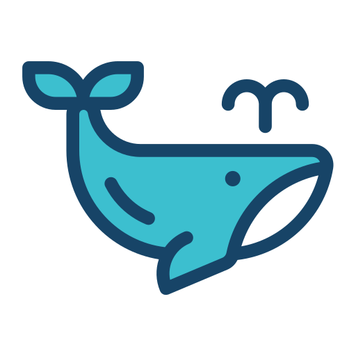

<p align="center">
  
</p>

<h1 align="center">Lingrove for Windows</h1>

<p align="center"><em>A Windows port of Lingrove's local-first autocomplete and language-learning app.</em></p>

<p align="center">
  <a href="LICENSE"></a>
  
  
</p>

---

Lingrove has two equally core capabilities: inline autocomplete and language learning while you
write. This repository is an early Windows port forked from
[Msde-7/cotabby-windows](https://github.com/Msde-7/cotabby-windows), which in turn builds on
[Cotabby](https://github.com/FuJacob/cotabby) by FuJacob, jam-cai, akramj13, and contributors.

The current Windows code contains an inherited Cotabby autocomplete implementation with a WPF tray
app, Windows UI Automation, local/endpoint inference paths, and portable policy tests. A scoped
[manual sentence-translation preview](docs/LEARNING_PREVIEW.md) now adapts the stable Mac contracts
through an independent local learning runtime or an explicitly selected learning endpoint.
[Local template resolution, token budgeting and model selection](docs/LEARNING_LOCAL_RUNTIME.md)
adapt the stable Mac behavior. Full capture/replacement, dictionaries, vocabulary notebook, Anki and
speech remain migration work, and native Windows interaction and model execution are unverified. The runtime and internal project
names still say Cotabby; Lingrove branding in this documentation does not claim that the app binary,
settings, or stored data have been rebranded or made compatible with macOS.

The [offline lexical index and lazy bundled store](docs/LEARNING_OFFLINE_LEXICON.md) adapt the
same pinned Mac resource and attribution. [Completed-translation double-click lookup](docs/LEARNING_WORD_PREVIEW.md)
now connects them to a bundled dictionary card; native hit/focus/placement checks and broader
system/imported dictionary flows remain incomplete.
The [contextual query library](docs/LEARNING_CONTEXTUAL_QUERY.md) and
[word/expression card](docs/LEARNING_CONTEXTUAL_CARD.md) now connect the Mac default sense page,
exact captured examples and lazy dictionary navigation to the local explanation service.
The [explanation input, prompt and output rules](docs/LEARNING_EXPLANATION_RULES.md) now have
Mac-backed portable coverage, including model capability/metadata gates. A local provider now
connects those rules to an exclusive native lease and complete-response validation. The app now
owns [independent local settings and runtime](docs/LEARNING_EXPLANATION_RUNTIME.md). The
[writing sentence card](docs/LEARNING_EXPLANATION_CARD.md) now connects explicit explanation,
stop and refresh to the [session](docs/LEARNING_EXPLANATION_SESSION.md), preserving complete
answers through refresh and revalidating the original editor. Native interaction/model execution
are unverified; the explanation endpoint remains unported.
The [writing capture adapter](docs/LEARNING_EXPLANATION_RULES.md#writing-capture-to-input) now preserves
the completed translation's target, exact occurrences and context receipt for the service.
The library service now adds saved-first lookup, profile/language isolation, complete records and
the Mac's bounded result cache. Its app-owned controller loads on demand and releases after 60 idle seconds.
The sentence card now has Mac's explicit [Copy source text / Copy translation](docs/LEARNING_COPY.md)
footer with immutable document guards; provisional translations cannot be copied.

The first foundation milestone is documentation, build-and-test CI, and shared behavior fixtures. It
does not add a Windows installer, downloadable build, artifact upload, release workflow, or model
download to CI. See the [baseline](docs/BASELINE.md) for what source exists and what remains
unverified.

## Current development scope

- **Autocomplete:** existing Core policies, WPF ghost overlay, UI Automation focus tracking,
  keyboard input, local LLamaSharp inference, optional configured endpoint, app/clipboard context,
  emoji, macros, and autocorrection. Source and tests exist, but native Windows editor behavior has
  not yet been verified across hosts.
- **Language learning:** a disabled-by-default manual current-sentence preview with independent
  task settings, cancellation, dedicated CPU local inference and an explicit learning chat endpoint.
  Local model import and catalog downloads require user actions; settings do not load a model.
  Source/model/style/budget rules follow the pinned Mac. Native capture/IME/card and model execution, replacement,
  reading/OCR, system/imported/online dictionaries, notebook, Anki and speech remain explicit gaps.
- **Privacy:** local generation is the default design. A remote endpoint is an explicit user choice;
  requests must be bounded and tied to the selected task. CI must not download model weights or
  contact model endpoints. Cloud sync is outside scope.

The full status and evidence for both feature sets lives in [PARITY.md](docs/PARITY.md). The
architecture and ownership map is in [ARCHITECTURE.md](ARCHITECTURE.md), and the staged completion
gates are in [PORTING_PLAN.md](docs/PORTING_PLAN.md).
The [guarded editor insertion boundary](docs/EDITOR_SAFETY.md) supplies exact capture
checks, queued-edit cancellation and bounded clipboard leases. Native editor acknowledgement and
IME handling remain open; long/truncated fields and unsupported clipboard formats fail closed.

## Repository layout

```text
src/Cotabby.App/       WPF app, tray, settings, onboarding, composition root
src/Cotabby.Core/      Portable values, policies, autocomplete orchestration
src/Cotabby.Inference/ Local llama.cpp/LLamaSharp and endpoint adapters
src/Cotabby.Win32/     UI Automation, keyboard, insertion, clipboard and Windows services
tests/                 xUnit portable and inference tests
resources/             Pinned learning data, source attribution and provenance
```

The existing `Cotabby` identifiers are retained through the migration. Read [AGENTS.md](AGENTS.md)
before contributing.

## Build and test

Use Windows 10 or 11 with the .NET 10 SDK to build and run the WPF app. On macOS, you can run the
portable Core suite and compare the shared JSON corpus against the pinned Swift policies. This
checkout has SDK `10.0.402` in the ignored `.dotnet/` directory, and `global.json` selects that SDK.
On a fresh checkout, install .NET SDK `10.0.402` into `.dotnet/` if it is not already available.

```powershell
dotnet build Cotabby.sln
dotnet test Cotabby.sln
```

On macOS, run these from the repository root. Set `--mac-repo` to a Git checkout containing the
pinned commit; the verifier reads its source with `git show`, so local edits in that checkout do not
change the reference:

```sh
export DOTNET_ROOT="$PWD/.dotnet"
export PATH="$DOTNET_ROOT:$PATH"
dotnet --version # 10.0.402
dotnet test tests/Cotabby.Core.Tests/Cotabby.Core.Tests.csproj --configuration Release
dotnet test tests/Cotabby.App.Tests/Cotabby.App.Tests.csproj --configuration Release
python3 scripts/verify-macos-parity.py --mac-repo /path/to/macOS-lingrove-checkout
python3 scripts/verify-learning-macos-parity.py --mac-repo /path/to/macOS-lingrove-checkout
python3 scripts/verify-learning-local-macos-parity.py --mac-repo /path/to/macOS-lingrove-checkout
python3 scripts/verify-learning-lexical-macos-parity.py --mac-repo /path/to/macOS-lingrove-checkout
python3 scripts/verify-learning-explanation-macos-parity.py --mac-repo /path/to/macOS-lingrove-checkout
python3 scripts/verify-learning-capture-macos-parity.py --mac-repo /path/to/macOS-lingrove-checkout
```

The Swift verifiers require Xcode 26 and exercise 17 autocomplete, 64 learning, 45 local-learning,
34 lexical, 19 dictionary-policy, 68 explanation, 52 explanation-model and 33 writing-capture fixture cases/checks, plus pinned resource integrity/Codable checks
against committed pure Mac policies. They do not build or launch the macOS app. Routine validation does not run the
`Cotabby.Tools.*Smoke` projects: those may require an interactive Windows desktop or downloaded
model weights.

Windows CI also executes the [compiled WPF learning-view suite](docs/WPF_VIEW_TESTS.md): actual
XAML/resource loading, window layout, in-memory rendering, native no-activation styles and
target-bound routed commands. It starts no product services and accesses no external editor.

Build and unit tests do not validate UI Automation, IME handling, caret placement, clipboard
restoration, host text insertion, or GPU inference. Those checks need a Windows host and are tracked
as explicit gates in the [porting plan](docs/PORTING_PLAN.md). Local model files are not CI inputs.

CI job ownership is explicit:

| Workflow | What it validates | What it does not do |
| --- | --- | --- |
| [`ci.yml`](.github/workflows/ci.yml) | Current .NET 10 tree: Windows x64 full build, unit tests and compiled WPF learning views; macOS 26 Core/App tests and the same JSON cases against pinned Swift policies | Does not run model smoke tools, download model weights, upload artifacts, package, or release |
| [`upstream-baseline.yml`](.github/workflows/upstream-baseline.yml) | Manual recheck of original fork commit `b1e4031c70aca1be21aae2c57b138fde5fc22bb1` on .NET 9 | Does not gate current .NET 10 PRs or validate native app behavior |

Current workflow results are available in the pull request checks. Recorded hosted and local results,
with the native validation limits, are in [BASELINE.md](docs/BASELINE.md).

## License and attribution

This project is licensed under the [GNU Affero General Public License v3.0](LICENSE), consistent
with its Cotabby upstream. Preserve the applicable upstream attribution and third-party notices in
[`THIRD_PARTY_LICENSES.md`](THIRD_PARTY_LICENSES.md). Third-party libraries, dictionaries, emoji
data, and model weights have their own terms; consult their notices before redistribution.
